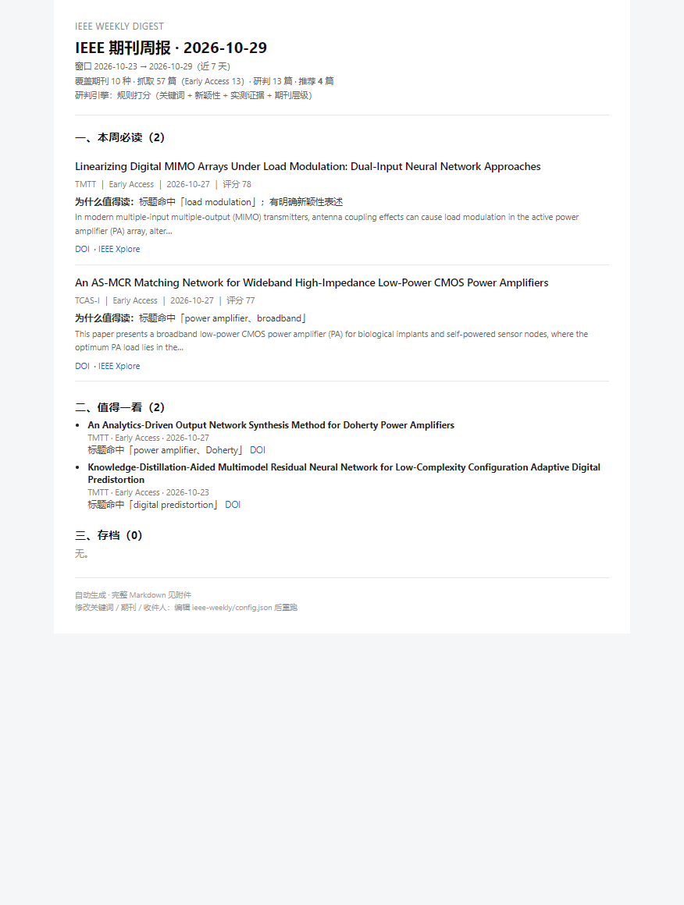

# ieee-weekly · IEEE 期刊 Early Access 周报

[](https://github.com/hxxhxhxx/ieee-weekly/actions/workflows/ci.yml)
[](LICENSE)

Weekly digest for IEEE Xplore journal Early Access: Crossref discovery → LLM per-paper screening → Markdown → email.
Tuned for compound-semiconductor (GaAs / GaN / InP) power-amplifier research; keywords, journals and thresholds live in one `config.json`.

按你设定的**关键词**盯住 **IEEE Xplore 期刊新收录/Early Access**，**逐篇研判**，生成 **Markdown 周报**并**发到邮箱**。



## 它解决什么问题

- **省掉"翻目录"这一步**：每周 10 本期刊的新文章（含 Early Access）自动汇总，不用挨个点开 TOC 看标题。
- **提前 3-6 个月看到同行进展**：Early Access 比正式见刊早，新架构、新工艺、实测数据都能先看到。
- **只留下与你方向相关的**：按 GaN/GaAs/InP 功率放大器打分，CMOS 降权、电力电子器件剔除，57 篇里通常只剩 3-5 篇值得读。
- **可追溯**：每篇都带 DOI / Xplore 链接、上线日期、关键指标，看到感兴趣的直接跳原文。

```
Crossref（DOI 收录时间，精确到"最近 N 天"）
   → IEEE Xplore（摘要 / Early Access 标记 / 作者 / 链接）
   → 关键词初筛 + 逐篇研判（DeepSeek 或规则打分）
   → Markdown + HTML 邮件（附 .md 文件）
   → 记录已读 DOI，下周自动去重
```

## 快速开始（3 步）

```powershell
cd D:\Deepseek_workplace\ieee-weekly

# 1) 填 Key 和邮箱（交互式，不回显，不经过聊天）
powershell -ExecutionPolicy Bypass -File .\setup.ps1

# 2) 先干跑一次，看效果（不写状态、不发信）
node src\cli.mjs --dry-run

# 3) 正式跑：生成报告 + 发邮件 + 记录去重
.\run-weekly.cmd
```

> 当前状态：SMTP 已配好（`smtp.mail.scut.edu.cn:465`，收件人 `mihexin@mail.scut.edu.cn`，2026-10-29 已实发验证）；
> 研判引擎已切到大模型（`deepseek-chat`）；定时任务 `IEEE-Weekly-Digest` 已注册，每周一 08:00，下次 2026-11-02。
> 改时间或重装：在**普通 PowerShell** 里执行 `install-task.ps1`（DSH 沙箱内访问不到任务计划服务）。

```powershell
powershell -ExecutionPolicy Bypass -File .\install-task.ps1                 # 默认周一 08:00
powershell -ExecutionPolicy Bypass -File .\install-task.ps1 -Day Friday -At 18:30
```

## 常用命令

| 命令 | 作用 |
| --- | --- |
| `node src\cli.mjs --dry-run` | 只看结果，不更新去重状态、不发信 |
| `node src\cli.mjs` | 正式跑一轮 |
| `node src\cli.mjs --days=14` | 临时把窗口放到 14 天 |
| `node src\cli.mjs --since=2026-10-01 --until=2026-10-15` | 指定任意历史窗口（补跑） |
| `node src\cli.mjs --no-email` | 生成报告但不发信 |
| `node src\cli.mjs --test-mail` | 只测 SMTP |
| `node src\cli.mjs --limit=40` | 限制送入研判的篇数 |

## 改配置：`config.json`

改完直接生效，不用改代码。

- **关键词**：`keywords[]`，`weight` 越大越重要，`core: true` 表示 PA 方向核心词（缺核心词会被判为边缘，避免"GaN 电力电子器件"混进来）。
- **期刊**：`journals[]`，`issn` 用来抓取，`tier` 影响评分（1 最高），`enabled: false` 可临时关掉。
- **阈值**：`scoring.mustReadScore / worthScore / minScore`，觉得推荐太多就调高。
- **研判模型**：`llm.model`、`llm.maxItems`（每轮最多研判多少篇）。
- **收件人**：`email.to`（数组）。
- **窗口**：`windowDays`（默认 7；定时任务每周跑一次，重叠部分靠 DOI 去重）。

## 产出

- `reports/ieee-weekly-YYYY-MM-DD.md` —— 周报正文
- `reports/last-email.html` —— 邮件渲染预览（双击即可用浏览器打开；也可 `node tools/serve.mjs reports 8791` 后访问 http://127.0.0.1:8791/last-email.html）
- `reports/last-run.json` —— 本轮每篇的分数与理由，方便调阈值
- `state/seen.json` —— 已推送过的 DOI（最多保留 5000 条）
- `logs/run.log` —— 定时任务运行日志

## 周报长什么样

```markdown
# IEEE 期刊周报 · 2026-10-29
> 窗口 2026-10-23 → 2026-10-29 ｜ 期刊 10 种 ｜ 抓取 57 篇（EA 13）｜ 研判 13 篇 ｜ 推荐 4 篇

## 一、本周必读（2 篇）
### 1. Linearizing Digital MIMO Arrays Under Load Modulation...
- 期刊／状态：TMTT ｜ Early Access
- 上线日期：2026-10-27（Crossref 收录时间）
- 为什么值得读：……
- 关键数据：PAE 62% @ 28 GHz；38 dBm
- 链接：DOI ｜ IEEE Xplore
```

## 开源与 DSH 插件

仓库已按可直接开源的布局整理：`LICENSE`(MIT)、`config.example.json`（已抹掉 key / 授权码）、`.gitignore`（`config.json`、`state/`、`reports/`、`logs/` 都不入库）。

```bash
git init && git add . && git commit -m "feat: IEEE early-access weekly digest"
gh repo create ieee-weekly --public --source=. --push
```

**做成 DSH 插件商城里的插件，技术上可行**，机制是这样的（从本机已装插件的 manifest 里确认的）：

- 插件就是一个**公开 npm 包**，`package.json` 里带 `keywords: ["dsh-plugin", ...]` 和 `dsh` 字段，例如：

  ```jsonc
  "dsh": {
    "bundle": { "patch": "./cordis.patch.yml" },
    "client": { "platform": "web", "inject": ["@deepseek-ai/dsh-client-ui-settings"], "immediately": true }
  },
  "peerDependencies": {
    "@deepseek-ai/dsh-tools": ">=0.2.1-rc.1 <0.3.0-0",
    "@deepseek-ai/schemastery": ">=0.2.1-rc.1 <0.3.0-0"
  }
  ```

- 市场会对每个包做**兼容性校验**（缓存里有 `version` / `enginesDsh` / `peerDependencies` 这几个字段），所以 peer 版本范围要跟着 DSH 主版本走。
- 也就是说：GitHub 放源码 + npm publish 公开包 → 市场能发现并安装。

**还差的一层**：当前是"CLI + Windows 计划任务"，不是 DSH 进程内的插件。要变成商城插件，需要再包一个 host 入口（`export function plugin`，注册一个 `ieee_weekly` 工具/命令去调这套 pipeline，配置走 `ctx.settings`），并在本地 profile 里安装验证一次。这一步我可以接着做——需要对着 `@deepseek-ai/dsh-tools` 的 SDK 类型开发，且装进 profile 后要重启 DSH 验证。

## 常见问题

**不在校园网 / 没有订阅？**
IEEE 的摘要和 Early Access 标记需要机构 IP（脚本会检测并在报告里提示）。校外请先连学校 VPN，或改成只用 Crossref 的标题+日期（会自动降级，但研判质量下降）。

**为什么有的条目没有摘要？**
IEEE 偶发 500/限流时会跳过；报告末尾的"抓取异常"会列出。重跑一次通常就好。

**为什么推荐篇数忽多忽少？**
Crossref 的 `created` 是 IEEE 注册 DOI 的时间，节假日会堆积，周一跑容易一次涌入较多。

**邮件发不出去？**
QQ 邮箱要在"设置 → 账户"开启 SMTP 并生成授权码；`smtp.qq.com:465`（SSL）。163 用 `smtp.163.com:465`，Gmail 用 `smtp.gmail.com:465` + 应用专用密码。

**想让推荐更准？**
配好 `llm.apiKey`（DeepSeek），研判会从"关键词规则"升级成逐篇读摘要打分；`scoring` 阈值只在规则模式下起作用。规则模式的排序偏粗（例如会把"植入式 CMOS PA"排得偏高），配了 key 后这类误判基本消失。

**加期刊？**
在 `journals` 里加 `{"name": "...", "issn": "...", "tier": 2, "enabled": true}`。ISSN 可在 Crossref 用 `https://api.crossref.org/journals/<issn>` 验证。

## 说明与边界

- 数据来源为 Crossref 公共 API 与 IEEE Xplore 站点检索接口，仅抓元数据与摘要，不下载全文；请控制频率（默认每篇间隔 450ms），仅个人科研使用。
- 单轮耗时约 1 分钟（视新论文数量）；定时任务设了 2 小时上限。
- 依赖 Node.js ≥ 20（本机 v24）与 `nodemailer`（已装在 `node_modules`）。
